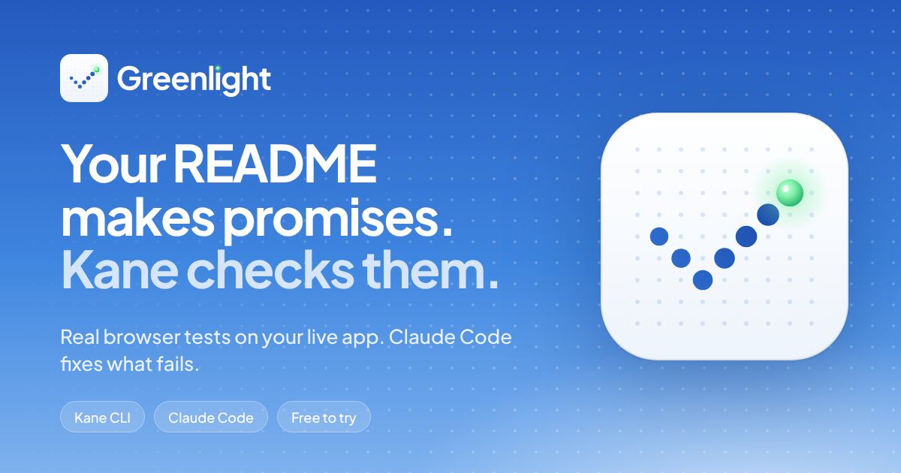

# Greenlight

**Does your app do what its README says?** Greenlight turns the promises in a README into claims, has **Kane CLI** test each one on the live app in a real browser, and gives a verdict per claim. When a claim fails, you paste one message into **Claude Code**: it reads Kane's verdict, fixes the code, pushes, and asks Kane to check again, until every claim passes.

Live app: **https://greenlight-api-xi.vercel.app/app** (no account needed)

Built for the Kane CLI Hackathon. Agent: **Claude Code**.



---

## Try it in five minutes

You don't need an account, a key or a credit card. Guest runs use our TestMu credits and have a daily cap.

1. Open **https://greenlight-api-xi.vercel.app/app** and click **Check my app** (top right).
2. Paste the demo app. It has one claim that works and one that is broken on purpose:
   - GitHub repository: `https://github.com/XDGram/GREENLIGHT` (the demo lives in `examples/demo-shop`)
   - Live app URL: `https://greenlight-demo-shop.vercel.app`
   - README: paste or upload [`examples/demo-shop/README.md`](examples/demo-shop/README.md)
3. Greenlight lists the claims and the exact credit cost. Click **Run**.
4. Watch Kane work (about 2 minutes). The verdict comes back claim by claim:
   - "Users can add items to the cart and the cart count goes up": **Passed**
   - "Users can subscribe to the newsletter with their email and see a confirmation": **Failed**, with what Kane saw.
5. Click **Connect Claude Code**, copy the message, and paste it into Claude Code in a clone of the repo. Claude Code fixes the newsletter bug, pushes, and asks Greenlight for a re-check. Kane passes both claims.

You can also try it on your own app: any public GitHub repository and its deployed URL.

**If a third-party service is down:** the sample check at **https://greenlight-api-xi.vercel.app/app/sample** shows a complete result page without running Kane. Section [Proof it works](#proof-it-works) lists real runs that already happened, with their ids and commits.

---

## How it works

```
 you                     Greenlight                     Kane CLI                  Claude Code
  │ repo, live URL,        │                               │                           │
  │ README ──────────────▶ │ claims + cost                  │                           │
  │ ◀───────────────────── │                               │                           │
  │ approve, Run ────────▶ │ one test per claim ──────────▶ │ real Chromium,             │
  │                        │                               │ clicks through the live app│
  │                        │ ◀──── passed, failed + notes ─ │                           │
  │ ◀── verdict per claim, │                               │                           │
  │     what Kane saw, fix │                               │                           │
  │ paste message ─────────┼───────────────────────────────┼─────────────────────────▶ │
  │                        │ ◀── GET /v1/checks/:id ────────┼────────────────────────── │ reads Kane's notes
  │                        │                               │                           │ fixes, commits, pushes
  │                        │ ◀── POST /v1/checks/:id/recheck┼────────────────────────── │
  │                        │ new run ─────────────────────▶ │ tests the new deploy       │
  │                        │ ◀──── passed ───────────────── │                           │
  │                        │ ── verdict ────────────────────┼─────────────────────────▶ │ stops when all pass
```

1. **Claims.** Every bullet point or line of the README (or your own notes) becomes one claim. You can edit, drop or add claims before anything runs.
2. **Approval and spend.** You see each test and the exact credit cost, and nothing runs until you approve it. Each run is capped, and the server has a total credit cap too.
3. **Kane tests the live app.** Each job runs in its own Vercel Sandbox (a short-lived microVM). Inside it, Kane CLI 0.10.6 drives a real Chromium against the deployed URL, with `--agent --local --no-adaptive-heal`. Kane can't quietly rewrite an approved test so that it passes.
4. **Verdict.** Greenlight classifies Kane's own result per test and rolls it up per claim: **Passed**, **Failed** (with Kane's note on what it saw and the step that failed), or **Could not verify** (the site didn't load, Kane errored). "Could not verify" never counts as passed and never goes to the fix loop.
5. **The closed loop.** The result page creates an agent token for that check and gives you one message to paste into Claude Code. It runs the [`/greenlight` command](skills/greenlight/commands/greenlight.md):
   - read the verdict (`GET /v1/checks/:id`);
   - fix the code behind each failed claim, using Kane's note as the symptom;
   - commit and push, then wait for the new deploy;
   - ask Kane to check again (`POST /v1/checks/:id/recheck`), and repeat until every claim passes (at most three rounds).

   The agent token can read checks and start re-checks. A re-check only re-runs tests you already approved, within the same credit caps. The token can't approve new tests.

---

## Proof it works

All of these are real Kane CLI runs against live deployments, through the production site (Supabase project records):

| Run | What happened |
|---|---|
| `job_318ca85431854f0a887d1d92f6446bbc` | Started by a person on the demo shop. Cart claim **Passed**. Newsletter claim **Failed**. Kane: "Three valid email submissions all returned 'Subscription failed. Please try again later.'" |
| commit [`6919b14`](https://github.com/XDGram/GREENLIGHT/commit/6919b14) | Claude Code's fix from that verdict: the form checked `res.status === "ok"` but the API answers `{ ok: true }`. |
| `job_160ed9123d7748d387eab3f4484cd93b` | Re-check **started by Claude Code** with its agent token after the push. Both claims **Passed**. |
| `job_5e09f9e662584ac3a637a63272f7da7d` → [`2ccfdcf`](https://github.com/XDGram/GREENLIGHT/commit/2ccfdcf) → `job_bd86feb988524a9180e410cd0f081e84` | The same loop a second time, after the bug was put back ([`944de35`](https://github.com/XDGram/GREENLIGHT/commit/944de35)): Failed, fixed by Claude Code, re-checked by the agent, Passed. |

The bug is in the demo shop again ([`a70e334`](https://github.com/XDGram/GREENLIGHT/commit/a70e334)), so the newsletter claim fails when you try it yourself.

---

## What's in the repository

| Path | What it is |
|---|---|
| `web/` | The app (React 18 + Vite): new check, live run view, verdict, Connect Claude Code. Built into `public/app/`. |
| `src/server/` | The API on Vercel Functions: checks, claims, approval and spend, jobs, the agent API (`/v1/checks`), guests, sandbox orchestration. |
| `src/server/sandbox.js`, `bin/greenlight-worker.js` | One Vercel Sandbox per job: installs the pinned Kane CLI and Chromium, runs the job, settles it. |
| `src/kane/` | Runs Kane as a subprocess, parses its NDJSON stream, enforces the flags and timeouts. |
| `src/verify/` | Turns Kane's exit code and final statuses into per-test and per-claim verdicts. |
| `src/credits/` | Estimates, authorises and reconciles Kane credit spend. |
| `skills/greenlight/` | The Claude Code side: the `/greenlight` command and the skill. |
| `examples/demo-shop/` | The demo app with one working and one broken claim. |
| `supabase/migrations/` | Postgres schema, row-level security, write-once records. |
| `docs/` | [API](docs/API.md), [CLI and certification](docs/CLI.md), [Supabase](docs/SUPABASE.md), [hosting](docs/HOSTING.md), [web app](docs/WEB.md). |

Stack: Node 20+ (ES modules), React 18, Vite, Vercel Functions and Sandbox, Supabase (Postgres and Storage), Kane CLI 0.10.6, `@sparticuz/chromium`.

---

## Run it yourself

Tests (no network, no Kane, no credits; a booby-trapped `kane-cli` on `PATH` fails the run if anything tries to call it):

```bash
npm install
npm test               # 460 tests
npm run typecheck:web
npm run build          # web app → public/app
```

Your own deployment needs:

- A Vercel project with this repository (Vercel Sandbox enabled).
- A Supabase project with `supabase/migrations/` applied (see [docs/SUPABASE.md](docs/SUPABASE.md)).
- A TestMu account for Kane CLI.

Set these environment variables:

| Variable | What it is |
|---|---|
| `SUPABASE_URL`, `SUPABASE_SERVICE_ROLE_KEY` | Database and storage (the key is secret) |
| `GREENLIGHT_KANE_USERNAME`, `GREENLIGHT_KANE_ACCESS_KEY` | Kane CLI login, passed only into the job's sandbox |
| `GREENLIGHT_PUBLIC_BASE_URL` | The deployment's public URL |
| `GREENLIGHT_APPROVAL_SIGNING_KEY` | Signs approvals; the worker checks the signature before spending |
| `GREENLIGHT_GUEST_MODE=on` | Lets people try it without an account |
| `GREENLIGHT_MAX_CREDITS_PER_RUN`, `GREENLIGHT_TOTAL_CREDIT_CAP` | Spend limits |

Every setting is in `src/server/config.js`.

To use the Claude Code command without the web page, copy `skills/greenlight/commands/greenlight.md` to `.claude/commands/` in your app's repository. Then set `GREENLIGHT_TOKEN` (an agent token) and `GREENLIGHT_CHECK`, and run `/greenlight`.

---

## Limits, honestly

- **Each run authors its tests fresh.** In local mode, Kane 0.10.6 keeps no replayable recording, so every run pays to author each test again. A 2-claim run costs about 90 to 100 credits. This is why every run needs an approved spend.
- **The live view shows only what the server knows.** While a run is going, Kane doesn't report per-claim progress, so the page shows the run's status, a timer and the claims, but not which claim Kane is on.
- **Deploy timing.** A re-check tests whatever is deployed at the live URL. The `/greenlight` command waits for the new deploy before asking for a re-check, but a slow deploy can mean testing the old version. Kane's notes make that visible.
- **Guest runs stay private.** They are capped per guest and per day and never become public records.
- **Fix suggestions.** Without an Anthropic API key configured, the result page's suggested fixes are generic. Kane's own note on what it saw is always shown.
